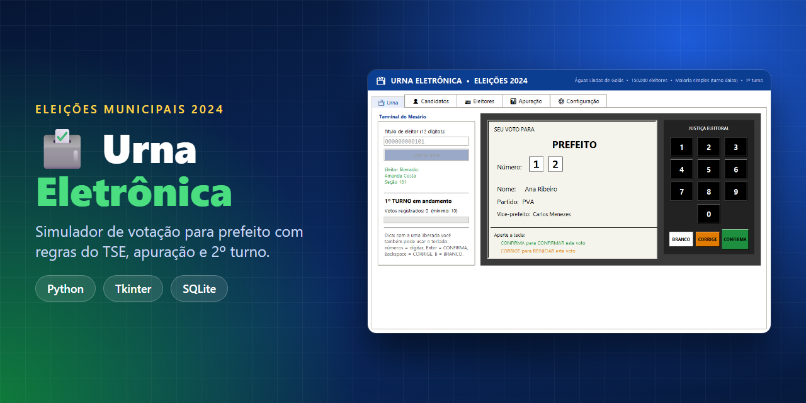
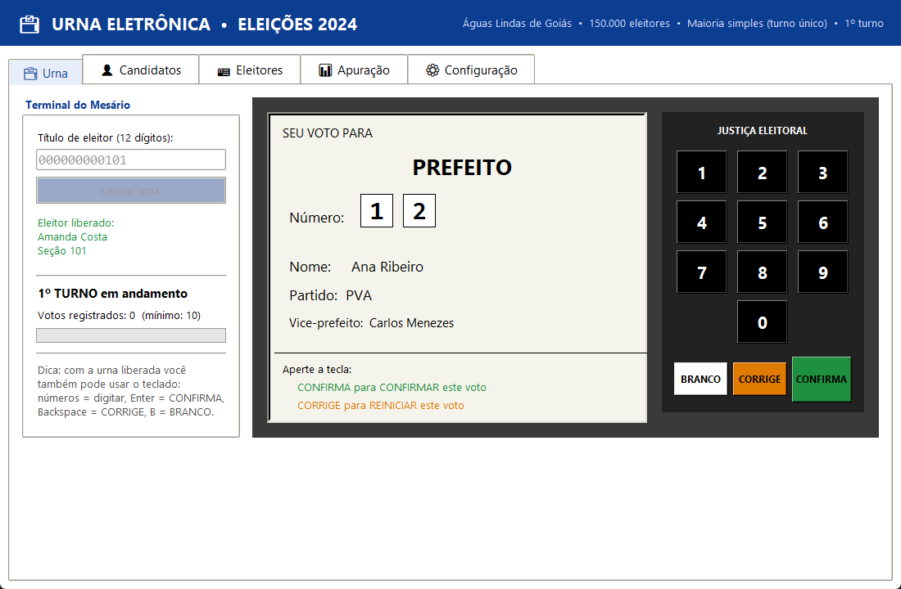
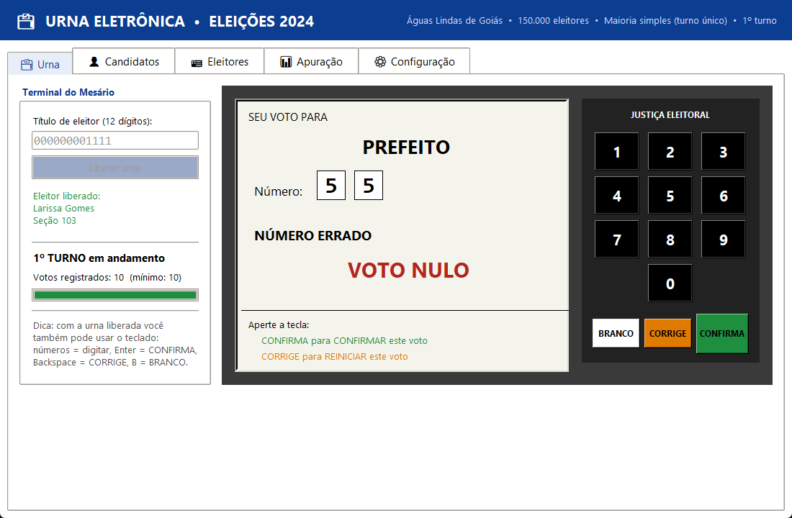
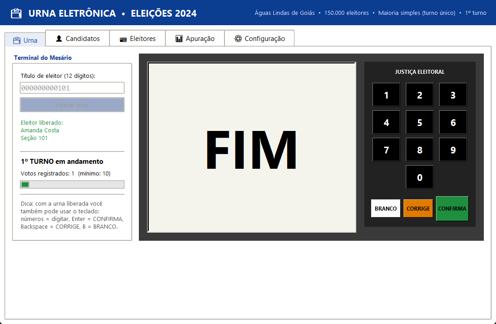
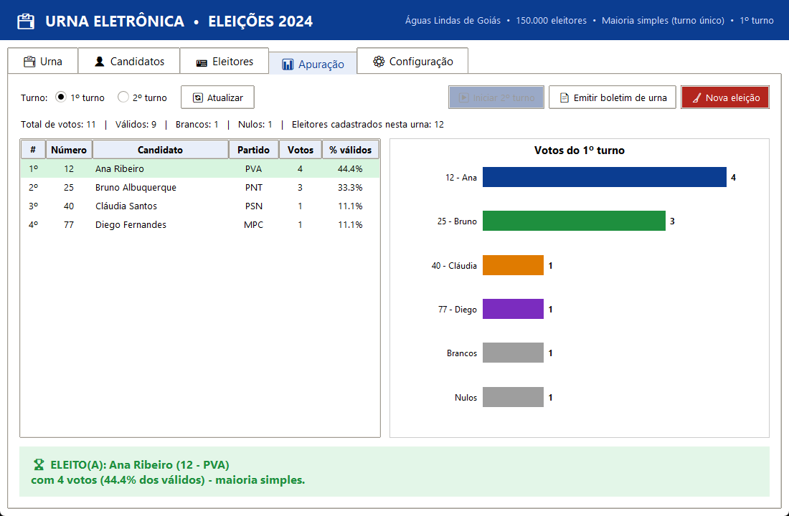
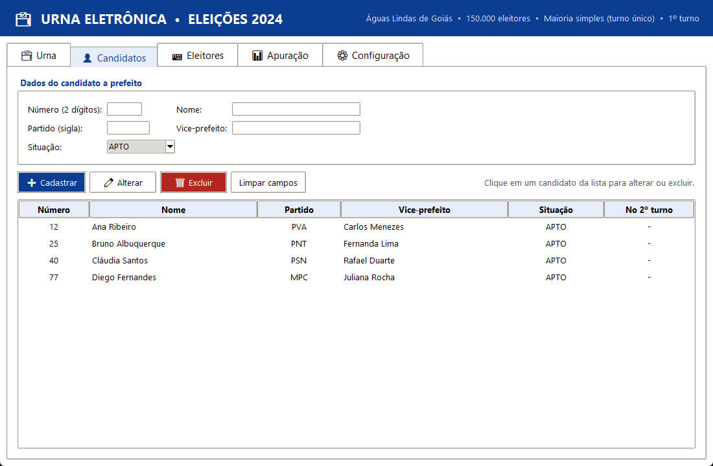
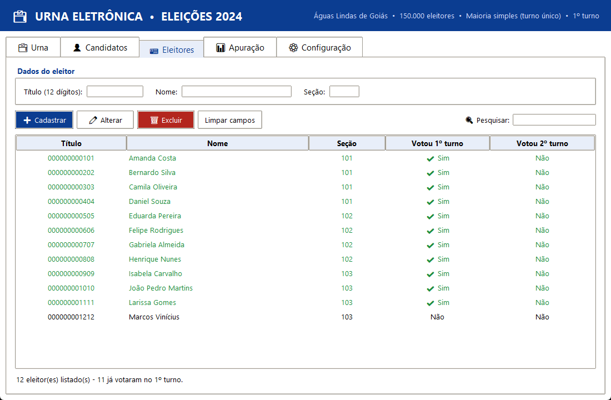
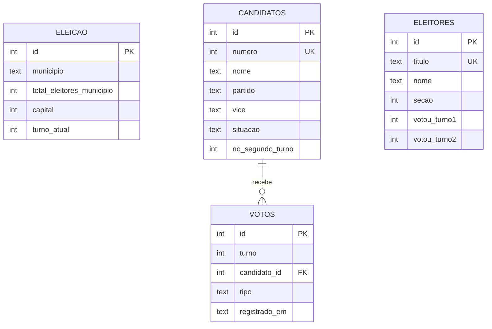

<p align="center">
  
</p>

<h1 align="center">🗳️ Urna Eletrônica — Eleições Municipais 2024</h1>

<p align="center">
  Simulador de urna eletrônica para a eleição de <b>prefeito</b>, com interface gráfica, banco de dados
  e as regras do sistema majoritário definidas pelo <b>TSE</b>.
</p>

<p align="center">
  
  
  
  
</p>

<p align="center">
  <a href="#-funcionalidades">Funcionalidades</a> •
  <a href="#-telas">Telas</a> •
  <a href="#-como-executar">Como executar</a> •
  <a href="#-regras-eleitorais">Regras</a> •
  <a href="#-banco-de-dados">Banco de dados</a> •
  <a href="#-estrutura-do-projeto">Estrutura</a>
</p>

---

## 📌 Sobre o projeto

Projeto desenvolvido para a **ATPS de Tópicos Avançados em ADS/SI**. O objetivo é simular o processo de uma
urna eletrônica: **cadastrar candidatos e eleitores**, **receber os votos** garantindo que cada eleitor vote
**uma única vez**, e **apurar o resultado** ao final, com todos os dados gravados em um banco **SQLite**.

Os dados de exemplo são do município de **Águas Lindas de Goiás (GO)** 💚. Os candidatos e eleitores são fictícios.

## ✨ Funcionalidades

| | Recurso | Descrição |
|---|---|---|
| 🗳️ | **Urna realista** | Tela e teclado iguais aos da urna: números, `BRANCO`, `CORRIGE`, `CONFIRMA`, voto nulo, tela **FIM** e som da urna |
| 🪪 | **Terminal do mesário** | O eleitor só vota depois de ser liberado pelo número do título |
| 🔒 | **Voto único** | O voto e a marcação de "já votou" são gravados na **mesma transação**; uma segunda tentativa é bloqueada |
| 🤫 | **Voto secreto** | A tabela de votos não guarda quem votou, apenas em quem |
| 👤 | **CRUD de candidatos** | Cadastrar, listar, alterar e excluir (número, nome, partido, vice e situação) |
| 👥 | **CRUD de eleitores** | Cadastrar, listar, pesquisar, alterar e excluir, mostrando quem já votou |
| 📊 | **Apuração** | Votos válidos, brancos e nulos, percentuais e gráfico de barras |
| 🔁 | **2º turno** | Calculado automaticamente quando a maioria absoluta é exigida e não é atingida |
| 📄 | **Boletim de urna** | Exporta o resultado em `.txt` |
| ⚙️ | **Configuração** | Município, número de eleitores e se é capital (define a regra aplicada) |
| ⌨️ | **Atalhos** | Números, `Enter` = CONFIRMA, `Backspace` = CORRIGE, `B` = BRANCO |

## 🖼️ Telas

<table>
  <tr>
    <td align="center"><b>Votação</b><br></td>
    <td align="center"><b>Voto nulo</b><br></td>
  </tr>
  <tr>
    <td align="center"><b>Fim da votação</b><br></td>
    <td align="center"><b>Apuração</b><br></td>
  </tr>
  <tr>
    <td align="center"><b>Candidatos</b><br></td>
    <td align="center"><b>Eleitores</b><br></td>
  </tr>
</table>

## 🚀 Como executar

**Pré-requisito:** Python 3.10 ou superior. O Tkinter e o SQLite já vêm com o Python, então **não é preciso instalar nada**.

```bash
git clone https://github.com/kauaxp77/Urna_eletronica.git
cd Urna_eletronica
python main.py
```

> No **PyCharm**: abra a pasta do projeto, clique com o botão direito em `main.py` e escolha **Run 'main'**.

Na primeira execução o arquivo `urna.db` é criado automaticamente a partir do
[`script_banco_de_dados.sql`](script_banco_de_dados.sql), com **4 candidatos** e **12 eleitores** de exemplo.
Para recomeçar do zero, basta apagar o `urna.db`.

### 🧪 Teste rápido

1. Na aba **Urna**, digite um título de exemplo (`000000000101`, `000000000202`, … até `000000001212`) e clique em **Liberar urna**.
2. Vote nos candidatos **12**, **25**, **40** ou **77**, em **BRANCO**, ou num número inexistente (ex.: **55**) para gerar voto **NULO**.
3. Tente votar de novo com o mesmo título e veja que o sistema bloqueia.
4. Depois de **10 votos ou mais**, abra a aba **Apuração** para ver o resultado.
5. Para testar o **2º turno**, antes de votar mude o total de eleitores para mais de 200 mil (ou marque "capital") na aba **Configuração**.

## ⚖️ Regras eleitorais

Baseadas na **Resolução TSE nº 23.677/2021**, alterada pela **nº 23.731/2024**:

| Situação do município | Regra | Segundo turno |
|---|---|---|
| Até 200 mil eleitores (não capital) | **Maioria simples**: vence quem tiver mais votos | ❌ Não há |
| Capital ou mais de 200 mil eleitores | **Maioria absoluta**: mais de 50% dos votos válidos | ✅ Entre os 2 mais votados, se ninguém passar de 50% |

- Votos **brancos e nulos** não são válidos.
- Se um finalista **desistir, morrer ou ficar impedido** antes do 2º turno, é convocado o remanescente mais votado. Basta alterar a situação do candidato.
- O resultado só é divulgado depois de **no mínimo 10 votos** no turno.

## 🗄️ Banco de dados



> 🔐 Não existe relação entre `ELEITORES` e `VOTOS`. É isso que garante o **sigilo do voto**.

## 📁 Estrutura do projeto

```
Urna_eletronica/
├── main.py                     # Interface gráfica (Tkinter): urna, cadastros, apuração e configuração
├── database.py                 # Conexão com o SQLite e operações de CRUD
├── apuracao.py                 # Regras eleitorais: maioria simples/absoluta, 2º turno e desistência
├── script_banco_de_dados.sql   # Criação das tabelas e dados de exemplo
├── ROTEIRO_DO_VIDEO.md         # Roteiro da apresentação em vídeo
├── LINK_DO_VIDEO_...txt        # Link do vídeo de apresentação
└── docs/                       # Banner e capturas de tela
```

## 🛠️ Tecnologias

- **Python 3**: linguagem principal
- **Tkinter / ttk**: interface gráfica
- **SQLite 3**: banco de dados (módulo `sqlite3`)
- **winsound**: som de "FIM" da urna (no Windows)

## 👨‍💻 Autor

Desenvolvido por **[kauaxp77](https://github.com/kauaxp77)** • Águas Lindas de Goiás — GO

<p align="center">⭐ Se curtiu o projeto, deixe uma estrela!</p>
